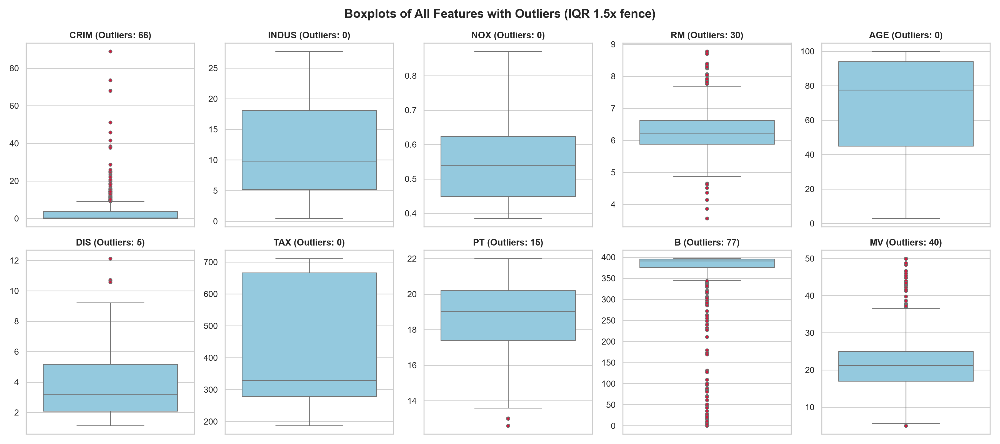
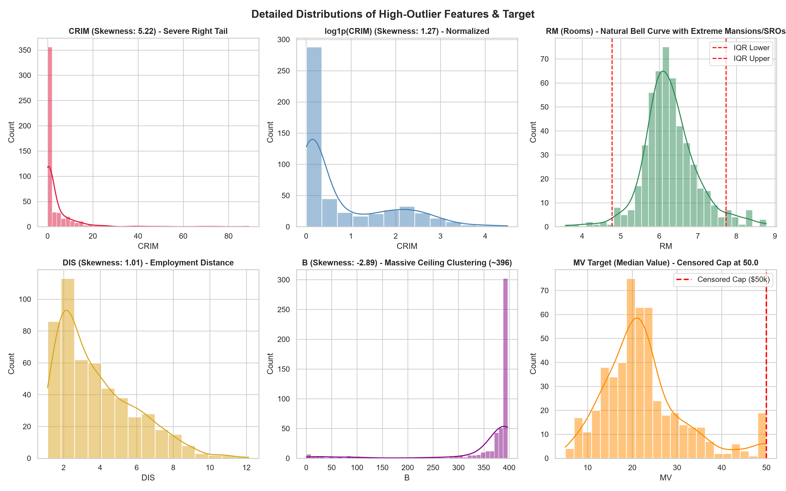
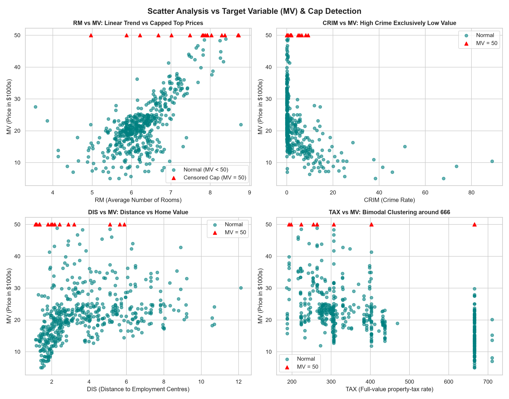
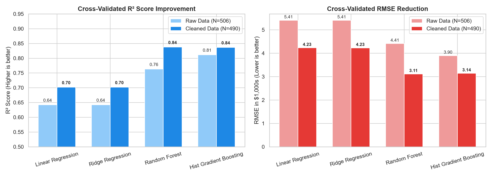
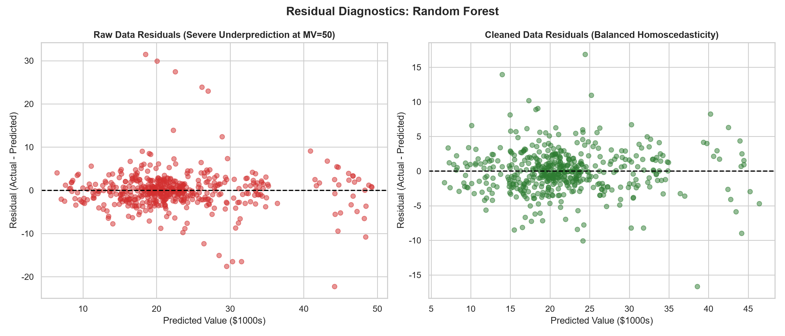
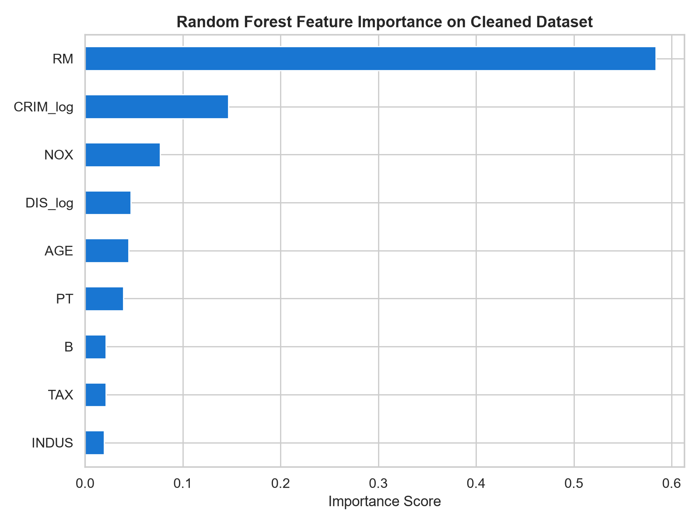

# 20261113 보스턴 주택 데이터셋 이상치 분석 및 머신러닝 파이프라인

본 저장소/폴더는 2026년 11월 13일 진행된 **보스턴 주택 가격(Boston Housing) 데이터셋의 이상치(Outlier) 진단, 시각화 기반 처리 기준 수립, 그리고 머신러닝 교차검증 비교 분석** 결과를 정리한 프로젝트입니다.

---

## 📌 프로젝트 개요 및 핵심 요약

- **분석 대상**: Kaggle `arpikr/boston` 데이터셋 (총 506행, 10개 변수)
- **주요 문제**:
  - 타깃 변수(`MV`)의 인위적 상한선 절단 (Censored Cap: $50k 이상 주택 16건 일괄 고정)
  - 특정 피처(`CRIM`, `DIS`)의 극심한 우측 편향(Skewness > 5.0)
- **이상치 처리 기준**:
  1. **Drop (제거)**: 타깃 변수 인위적 Capped 데이터 `MV == 50.0` (16건 제거, 전체의 3.1%)
  2. **Log1p (변환)**: 극심한 편향 피처 `CRIM`, `DIS`는 삭제 대신 로그 변환(`log1p`)으로 100% 정보 보존 및 정규화
  3. **Keep (보존)**: 방 개수(`RM`)의 자연 극단값은 삭제하지 않고 트리 기반 앙상블 모델(Random Forest)로 학습
- **최종 검증 성과 (5-Fold CV 기준)**:
  - 설명력($R^2$): **0.763 $\rightarrow$ 0.838 (+0.075 대폭 향상)**
  - 예측 오차(RMSE): **$4,414 $\rightarrow$ $3,115 (-29.4% 급감)**
  - 평균 절대 오차(MAE): **$2,640 $\rightarrow$ $2,265 (-14.2% 개선)**

---

## 📊 시각화 분석 결과

### 1. 전체 피처 상자그림 (Boxplots & IQR 1.5x)

### 2. 주요 편향 피처 분포 및 로그 변환 효과

### 3. 타깃 변수(MV) 산점도 및 Censored Cap 왜곡 확인

### 4. 4개 모델 성능 비교 (Raw vs Clean)

### 5. 잔차 진단 및 피처 중요도
| 잔차 진단 (오차 등분산성 회복) | Random Forest 피처 중요도 |
| :---: | :---: |
|  |  |

---

## 📈 교차 검증(5-Fold CV) 수치 비교표

| 모델명 | 원본 $R^2$ | **정제 후 $R^2$** | 원본 RMSE ($1,000) | **정제 후 RMSE** | 원본 MAE ($1,000) | **정제 후 MAE** |
| :--- | :---: | :---: | :---: | :---: | :---: | :---: |
| **Linear Regression** | 0.642 | **0.702** | 5.41 | **4.23** (-22%) | 3.57 | **3.05** |
| **Ridge Regression** | 0.642 | **0.702** | 5.41 | **4.23** (-22%) | 3.57 | **3.04** |
| **Random Forest** | 0.763 | **0.838** | 4.41 | **3.11** (-29%) | 2.64 | **2.27** |
| **Hist Gradient Boosting** | 0.812 | **0.837** | 3.90 | **3.14** (-19%) | 2.52 | **2.24** |

---

## 📂 파일 구성 안내

- `README.md`: 프로젝트 전체 분석 보고서 및 설명서
- `dashboard.html`: 인터랙티브 Chart.js 및 전체 차트가 내장된 독립 실행형 웹 대시보드
- `boston.csv`: Kaggle에서 수집한 보스턴 주택 원본 데이터셋
- `boston_clean.csv`: 인공 상한치 제거 및 로그 변환이 완료된 정제 데이터셋
- `outlier_analysis.py`: 이상치 통계 검정(IQR, Z-Score) 및 3종 차트 생성 스크립트
- `preprocess_data.py`: 이상치 처리 및 정제 데이터셋 생성 파이프라인
- `train_and_evaluate.py`: 4개 회귀 모델 5-Fold 교차 검증 및 잔차 진단 스크립트
- `build_html_dashboard.py`: Base64 내장형 웹 대시보드 HTML 빌더 스크립트
- `outlier_summary.csv`: 전체 피처별 이상치 정밀 통계 수치
- `model_performance_comparison.csv`: 모델별 전후 성능 지표 비교 수치
- `plots/`: 생성된 모든 고해상도 시각화 차트 이미지 (PNG)
